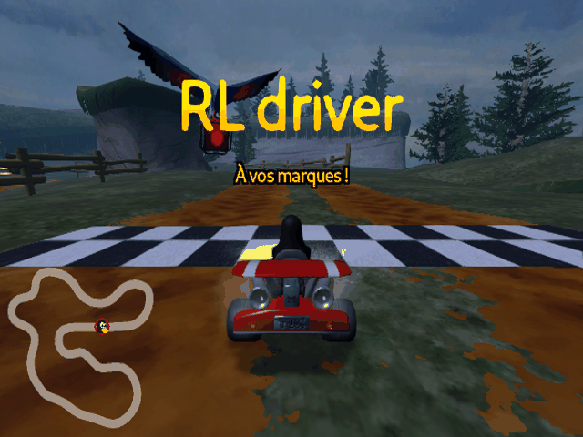
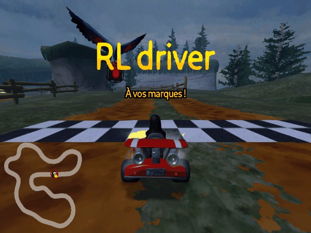
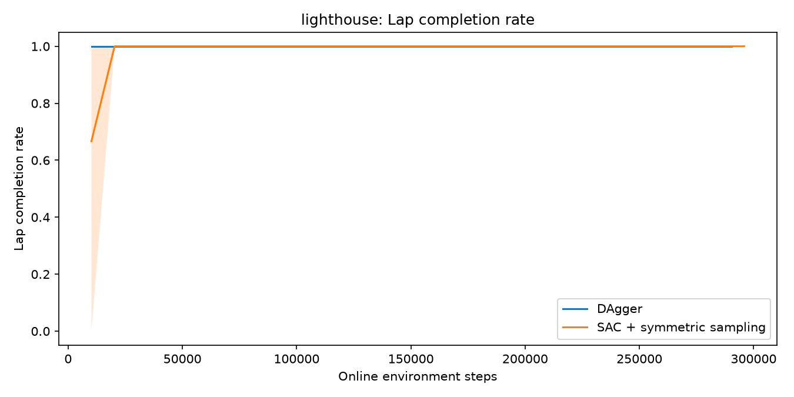
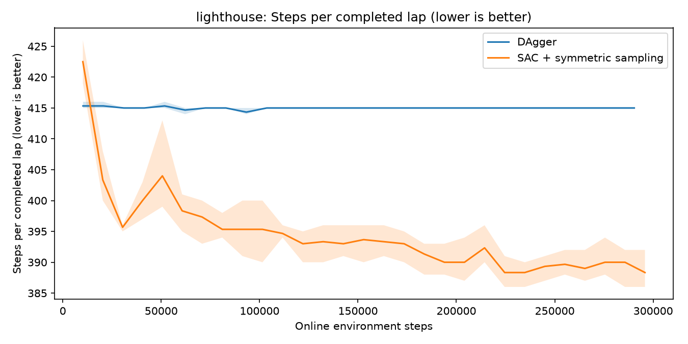
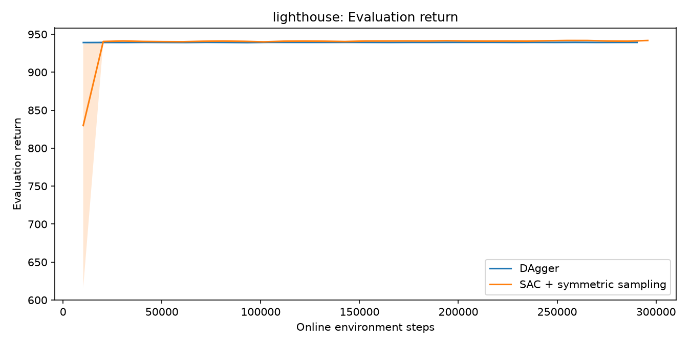
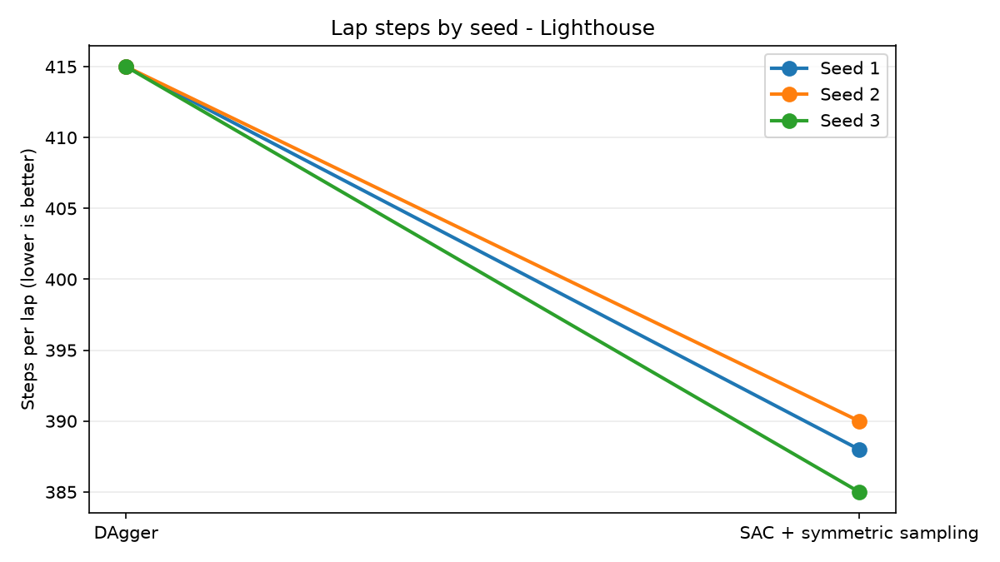
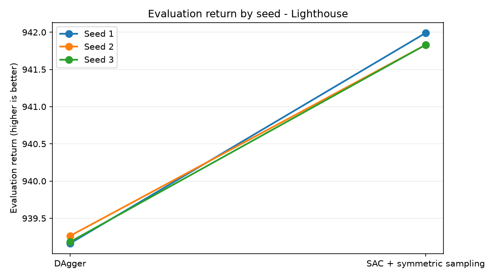
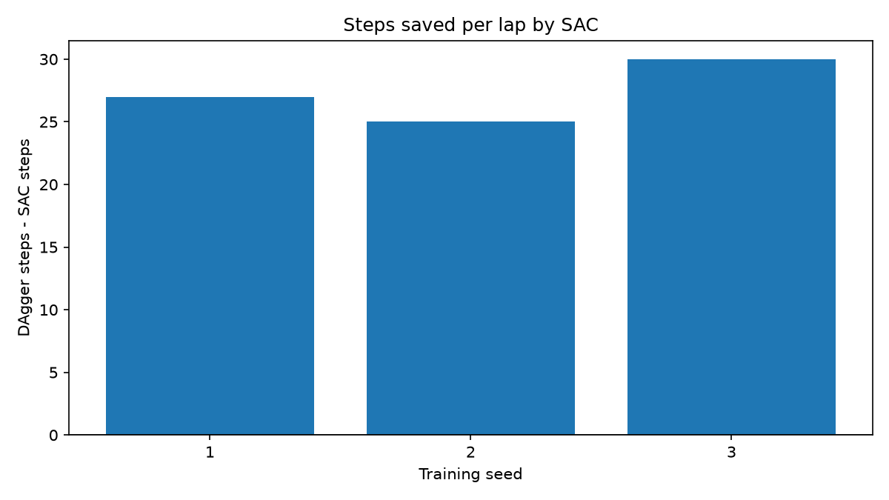
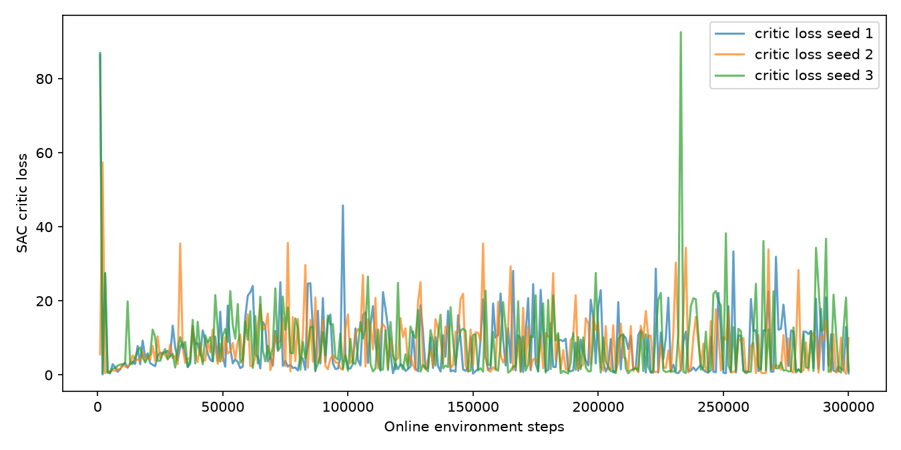

# SuperTuxKart — DAgger vs SAC with Symmetric Sampling

A reinforcement learning mini-project comparing two ways of training an agent to drive a kart around the **Lighthouse** track in [SuperTuxKart](https://supertuxkart.net/).

We tested **DAgger**, which learns to imitate an expert, and **Soft Actor-Critic (SAC) with symmetric sampling**, which learns from a mix of expert demonstrations and its own experience.

## Watch the trained agents

Both GIFs show **seed 1** driving on Lighthouse. These are actual recordings of the trained policies, not videos of the expert.

| DAgger | SAC + symmetric sampling |
|:--:|:--:|
|  |  |
| ~415 steps per lap | ~388 steps per lap |

> The GIFs are demonstrations from one seed. The numerical results below are averaged over **three training seeds**.

## Results

Both methods were trained with **300,000 online environment steps per seed**, using seeds **1, 2 and 3**. Evaluation took place on the same track, with one kart and one lap.

| Metric | DAgger | SAC + symmetric sampling |
|---|---:|---:|
| Lap completion rate | 100% | **100%** |
| Average steps per completed lap ↓ | 415.00 | **387.67** |
| Average evaluation return ↑ | 939.20 | **941.88** |
| Online training steps per seed | 300,000 | 300,000 |
| Training seeds | 3 | 3 |

**Main finding:** SAC completed a lap in about **27.3 fewer steps** on average, which is **6.6% fewer steps** than DAgger. Both agents finished every lap in the reported final evaluations.

### Learning curves

**Lap completion rate**

**Lap steps** (lower is better)

**Evaluation return**

### Final comparison across seeds

| Lap steps by seed | Return by seed |
|:--:|:--:|
|  |  |

SAC critic loss during training

## How the agents were trained

- **Environment:** `supertuxkart/full-v0`, Lighthouse, one kart, one lap, up to 20 path points in the observations.
- **Controls:** acceleration and steering (two continuous actions).
- **Expert:** the existing Team 4 driving agent from [`pystk_project`](https://github.com/osigaud/pystk_project), used to collect the initial demonstrations.
- **DAgger:** trains on expert actions and adds new states visited by its learner, labeled by Team 4.
- **SAC + symmetric sampling:** updates its policy using batches split **50% expert transitions / 50% online transitions**.
- **Evaluation:** five laps at each training checkpoint, with a final evaluation of 20 laps per seed.

The neural network settings, reward implementation, training loops, and saved outputs are in [`SuperTuxKart.ipynb`](SuperTuxKart.ipynb).

## Notebook files

- [`SuperTuxKart.ipynb`](SuperTuxKart.ipynb) — environment, expert demonstrations, DAgger, SAC, experiments and result plots.
- [`Watch_Agents.ipynb`](Watch_Agents.ipynb) — loads trained model checkpoints to record the agents driving. Running this requires the saved `.pt` checkpoints and a graphics-capable SuperTuxKart installation.

**To run the notebooks**, install the Python dependencies, set the local path to the [`pystk_project`](https://github.com/osigaud/pystk_project) repository, and make sure SuperTuxKart assets and the model checkpoints are available. The original experiment ran on a university Jupyter server, so its absolute paths may need to be updated on another computer.

## Conclusion

On Lighthouse, **both methods completed the lap reliably**, but **SAC with symmetric sampling was faster** and achieved a slightly higher return.

DAgger learned to reproduce Team 4's driving behavior, while SAC optimized the reward using both demonstrations and online experience. This is one possible reason SAC improved beyond the expert's lap time.

These results are limited to **one track and three training seeds**. Also, DAgger requests additional expert labels during training, while SAC reuses the collected demonstrations, so the methods have the same online-step budget but not the same expert-labeling cost.
